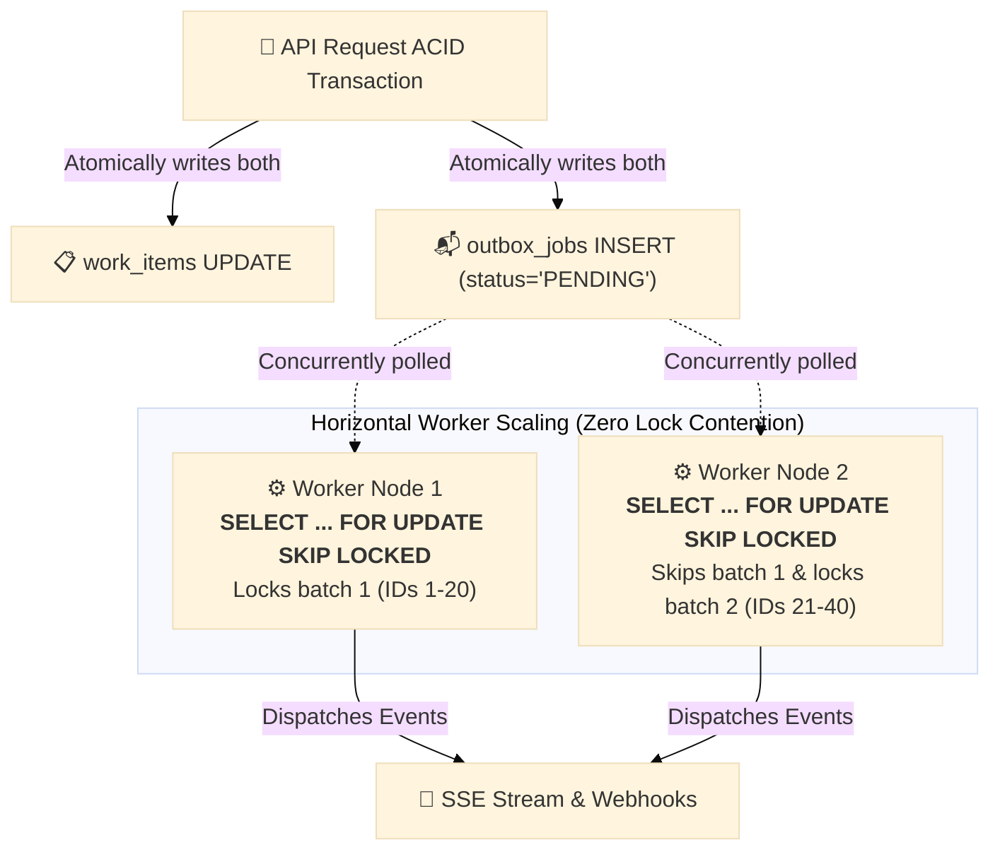
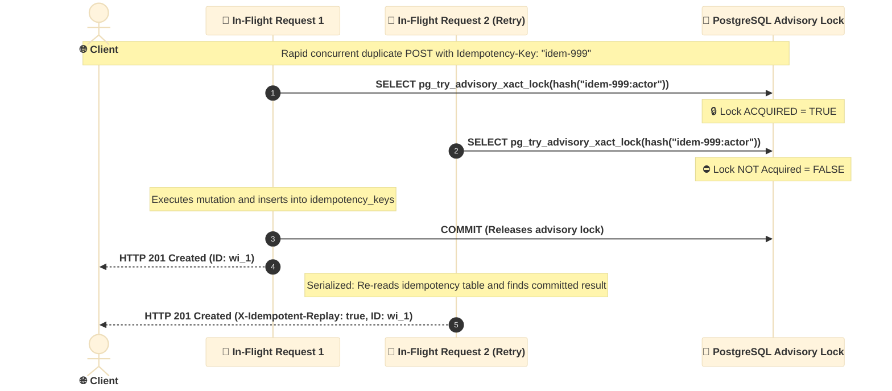

# OpsPulse — Engineering Decisions

**Project:** OpsPulse — High-Concurrency Operational Work-Coordination Engine  
**Challenge:** Newtonite Software Engineering Challenge ("Operations Under Pressure")  
**Last Updated:** 2026-10-17  

---

## Table of Contents

1. [Zero-ORM Philosophy & Raw Parameterized SQL](#1-zero-orm-philosophy--raw-parameterized-sql)
2. [Optimistic Concurrency Control (OCC)](#2-optimistic-concurrency-control-occ)
3. [Atomic Claiming with SELECT FOR UPDATE](#3-atomic-claiming-with-select-for-update)
4. [Idempotency Layer Design](#4-idempotency-layer-design)
5. [Deterministic State Machine](#5-deterministic-state-machine)
6. [Approval Gate & Separation of Duties](#6-approval-gate--separation-of-duties)
7. [Transactional Outbox Pattern (SKIP LOCKED)](#7-transactional-outbox-pattern-skip-locked)
8. [Keyset Cursor Pagination vs OFFSET](#8-keyset-cursor-pagination-vs-offset)
9. [GIN Full-Text Search Index](#9-gin-full-text-search-index)
10. [In-Flight Idempotency Race Hardening (Module 2)](#10-in-flight-idempotency-race-hardening-module-2)
11. [Approval Invalidation on Re-Investigation (Module 2)](#11-approval-invalidation-on-re-investigation-module-2)
12. [Benchmark Cleanup Pattern (Module 2)](#12-benchmark-cleanup-pattern-module-2)
13. [Windows AsyncIO Compatibility](#13-windows-asyncio-compatibility)

---

## 1. Zero-ORM Philosophy & Raw Parameterized SQL

**Decision:** All database access uses `psycopg` v3 with explicit, parameterized raw SQL inside ACID transaction blocks. No SQLAlchemy, no Tortoise ORM.

**Rationale:**
- ORM layer magic (lazy loading, implicit dirty-tracking flushes, auto-generated JOINs) obscures lock ordering and can introduce phantom reads, implicit transactions, and hard-to-detect deadlocks.
- `FOR UPDATE`, `SKIP LOCKED`, and `version = expected_version` checks must be 100% deterministic and directly inspectable in EXPLAIN ANALYZE output. ORM frameworks typically cannot guarantee this without workarounds that erode their value proposition.
- Using `psycopg_pool.AsyncConnectionPool` gives precise control over connection lifecycle, pool sizing, and event loop compatibility (critical on Windows).
- Parameterized queries (never string-formatted SQL) prevent SQL injection at the layer where it matters most.

**Trade-off accepted:** More verbose code and manual result-to-model mapping (via `psycopg.rows.dict_row`). This is explicitly acceptable for a high-stakes, concurrency-critical system.

---

## 2. Optimistic Concurrency Control (OCC)

**Decision:** Every mutating request against a work item requires an `expected_version: int` parameter. The UPDATE uses a conditional WHERE clause:

```sql
UPDATE work_items
SET ..., version = version + 1
WHERE id = $1 AND version = $2
RETURNING *;
```

If `rowcount == 0`, the current row is fetched and returned as `current_state` inside a `409 STALE_VERSION_CONFLICT` error.

**Rationale:**
- OCC is preferable to pessimistic locking (long-held locks) for concurrent read-heavy workloads.
- The `version` column is a simple monotonically increasing integer — cheap to compare, index-friendly.
- Returning `current_state` on conflict allows the client to present a diff to the user ("your version vs. current version") for intelligent conflict resolution, instead of forcing a blind retry.
- Alternative (last-write-wins) was rejected because it silently loses data in concurrent edit scenarios — unacceptable for an operational incident system where stale overwrites can be catastrophic.

---

## 3. Atomic Claiming with SELECT FOR UPDATE

**Decision:** The claim endpoint acquires a row-level exclusive lock on the target work item using `SELECT ... FOR UPDATE` before any state mutation:

```sql
SELECT * FROM work_items WHERE id = $1 FOR UPDATE;
```

This entire read → check → update sequence runs inside a single ACID transaction.

```mermaid
%%{init: {
  'theme': 'base',
  'themeVariables': {
    'fontFamily': 'Inter, system-ui, -apple-system, sans-serif'
  },
  'sequence': {
    'actorFontSize': 16,
    'actorFontWeight': 700,
    'noteFontSize': 14,
    'noteFontWeight': 600,
    'messageFontSize': 14,
    'messageFontWeight': 600,
    'width': 200,
    'height': 45,
    'boxMargin': 10,
    'messageMargin': 30
  }
}}%%
sequenceDiagram
    autonumber
    actor Op1 as 👤 Operator 1
    actor Op2 as 👤 Operator 2
    participant DB as 🐘 PostgreSQL (work_items)

    Note over Op1, DB: Two operators attempt to claim wi_showcase_01 at the same time
    Op1->>DB: BEGIN Tx 1; SELECT * WHERE id = 'wi_1' FOR UPDATE;
    Note over DB: 🔒 Row Lock GRANTED to Tx 1
    Op2->>DB: BEGIN Tx 2; SELECT * WHERE id = 'wi_1' FOR UPDATE;
    Note over DB: ⏳ Tx 2 BLOCKED on DB lock

    Op1->>DB: UPDATE SET assignee_id = 'usr_aarav', status = 'INVESTIGATING';
    Op1->>DB: COMMIT Tx 1;
    Note over DB: 🔓 Lock RELEASED

    Note over DB: 🔒 Tx 2 unblocks & inspects row:<br/>assignee_id is NOT NULL!
    DB-->>Op2: Returns HTTP 409 Conflict (ALREADY_CLAIMED)
```

**Rationale:**
- Without row-level locking, two concurrent claim requests could both read `assignee_id IS NULL`, both pass the "available" check, and both execute an UPDATE, resulting in the same item claimed twice by different operators. This is the classic lost-update anomaly.
- `FOR UPDATE` causes the second concurrent request to block at the DB level until the first commits or rolls back. The second then reads the committed `assignee_id` and correctly returns `409 ALREADY_CLAIMED`.
- Alternative considered: application-level Redis locks. Rejected because they introduce a second distributed system that can diverge from the DB state, creating split-brain scenarios. DB-native locks are always consistent with the transactional data.
- The benchmark proves exactly 1 winner under 8 concurrent claimants.

---

## 4. Idempotency Layer Design

**Decision:** Mutating endpoints (POST create, claim, transition, approve) accept an `Idempotency-Key` HTTP header. The system stores `(idempotency_key, actor_id, request_hash, status_code, response_body)` in a dedicated `idempotency_keys` table with a `UNIQUE(idempotency_key, actor_id)` constraint.

**Key design choices:**
- **SHA-256 request fingerprint:** The `request_hash` is `sha256(endpoint + sorted_json_body)`. If the same key is replayed with a different body, the system returns `422 IDEMPOTENCY_KEY_PAYLOAD_MISMATCH` rather than silently returning the cached result for a different operation. This prevents key collision attacks.
- **Actor-scoped uniqueness:** Keys are scoped per `(actor_id)`, preventing cross-actor replay attacks where Actor A sends Actor B's idempotency key.
- **ON CONFLICT DO NOTHING:** The INSERT uses `ON CONFLICT ... DO NOTHING` to handle the rare case where two identical requests arrive so close together that both miss the cached record on the initial read. The row is only saved by whoever commits first; the other's NO-OP insert causes no data duplication.

**Rationale:**  
Network retries are a fundamental reality in distributed systems. Without idempotency, a client retrying after a timeout could create duplicate work items or trigger an operation twice. The header-based approach is REST-standard (as used by Stripe, PayPal, etc.) and requires no special client state beyond a UUID per operation.

---

## 5. Deterministic State Machine

**Decision:** Work item status transitions are governed by an explicit directed acyclic graph (DAG) defined in `ALLOWED_TRANSITIONS`. Any transition not in the graph is rejected with `422 INVALID_TRANSITION`.

```mermaid
%%{init: {
  'theme': 'base',
  'themeVariables': {
    'fontSize': '16px',
    'fontFamily': 'Inter, system-ui, -apple-system, sans-serif'
  }
}}%%
stateDiagram-v2
    direction TB
    [*] --> TRIAGE : Task Created
    
    TRIAGE --> INVESTIGATING : Atomic Claim (FOR UPDATE)
    TRIAGE --> BLOCKED : External Dependency
    TRIAGE --> CLOSED : Rejected / Duplicate
    
    INVESTIGATING --> PENDING_APPROVAL : Submit for Review
    INVESTIGATING --> RESOLVED : Direct Resolve (requires_approval=False)
    INVESTIGATING --> BLOCKED : Waiting on External Team
    
    PENDING_APPROVAL --> APPROVED : Independent Sign-off (RBAC + SoD)
    PENDING_APPROVAL --> INVESTIGATING : Changes Requested
    PENDING_APPROVAL --> BLOCKED : Compliance Escalation
    
    APPROVED --> RESOLVED : Complete Resolution
    APPROVED --> INVESTIGATING : Re-open (Resets Approval to PENDING)
    APPROVED --> BLOCKED : Pre-deployment Stop
    
    BLOCKED --> INVESTIGATING : Dependency Cleared
    BLOCKED --> TRIAGE : Return to Triage
    
    RESOLVED --> CLOSED : Archive & Settle
    RESOLVED --> INVESTIGATING : Bug Resurfaced (Re-open)
    
    CLOSED --> [*]

    note right of APPROVED
        <b>Approval Gatekeeper:</b>
        Transition to RESOLVED requires
        approval_status == 'APPROVED'.
    end note

    note left of INVESTIGATING
        <b>Re-open Invalidation:</b>
        Moving back to INVESTIGATING
        resets approval_status to PENDING
        and clears approved_by.
    end note
```



**Rationale:**
- An explicit state graph prevents "magic jumps" (e.g., TRIAGE directly to CLOSED, bypassing all review steps). In an operational system, these shortcuts are compliance violations.
- The state machine is defined as a plain Python dictionary — no DSL, no framework. This makes it completely transparent and trivially testable.
- Forward-only transitions (except specific allowed re-opens) ensure audit trail integrity: you cannot step backwards to a state that would erase the audit trail meaning.

---

## 6. Approval Gate & Separation of Duties

**Decision:** Two independent enforcement layers apply on approval-requiring items:

1. **Approval Gate:** `RESOLVED` transition is blocked with `422 APPROVAL_GATE_LOCKED` if `requires_approval == True AND approval_status != 'APPROVED'`.
2. **Separation of Duties:** The approve endpoint blocks the action with `403 SEPARATION_OF_DUTIES_VIOLATION` if `actor_id == assignee_id` OR `actor_id == created_by_id`.

**Rationale:**
- These are standard internal control requirements in financial and compliance operations. No operator should be able to resolve their own high-risk change without an independent review.
- Both checks are enforced at the service layer (in the same transaction as the state mutation), not just at the API layer. This prevents bypass via direct service invocation in future integrations.
- RBAC (Approver/Lead role required) provides a third independent layer.

---

## 7. Transactional Outbox Pattern (SKIP LOCKED)

**Decision:** Every successful work item mutation atomically inserts an event record into `outbox_jobs` in the same database transaction. A background worker polls pending jobs using:

```sql
SELECT id, event_type, ...
FROM outbox_jobs
WHERE status = 'PENDING' AND next_attempt_at <= NOW()
ORDER BY next_attempt_at ASC
LIMIT 20
FOR UPDATE SKIP LOCKED;
```



**Rationale:**
- The Transactional Outbox Pattern guarantees that domain events are published if and only if the business transaction commits. No message can be lost due to a crash between the DB commit and sending to a message broker.
- `SKIP LOCKED` allows multiple concurrent worker processes to each pick up a non-overlapping subset of jobs without blocking each other — providing horizontal scalability with zero additional infrastructure (no Redis, no Zookeeper leader election).
- Exponential backoff (`2 ** attempts` seconds) and a `DEAD_LETTER` state after `max_attempts` prevent a single failing job from consuming all worker cycles.
- A partial index on `(next_attempt_at) WHERE status = 'PENDING'` ensures the poll query remains O(log n) even with millions of historical completed/dead-letter records.

---

## 8. Keyset Cursor Pagination vs OFFSET

**Decision:** The `GET /api/v1/work-items` list endpoint uses keyset cursor pagination (also called continuation tokens) rather than `OFFSET N LIMIT K`:

```sql
-- Keyset (fast, O(1) B-Tree seek at any depth):
SELECT ... FROM work_items
WHERE (updated_at, id) <= ($cursor_updated_at, $cursor_id)
ORDER BY updated_at DESC, id DESC LIMIT 50;

-- Offset (slow, O(N) scan at depth N):
SELECT ... FROM work_items
ORDER BY updated_at DESC OFFSET 5000 LIMIT 50;
```

The cursor is encoded as a URL-safe base64 JSON token `{"u": "<iso8601>", "id": "<uuid>"}`.

**Rationale:**
- At OFFSET 5000, PostgreSQL must materialize and discard 5,000 rows before returning the page. At OFFSET 50,000, it materializes 50,000 rows. Cost grows linearly with page depth.
- A composite B-Tree index on `(updated_at DESC, id DESC)` allows the keyset query to find the start position in O(log N) time regardless of depth.
- Benchmarks on the 10,015-item dataset show keyset delivering consistent sub-5ms results at equivalent depth while OFFSET degrades with dataset growth.
- Cursor-based pagination is also cursor-stable: items added or removed between pages don't cause duplicates or skips, which OFFSET cannot guarantee.

---

## 9. GIN Full-Text Search Index

**Decision:** The `work_items` table includes a generated tsvector column:

```sql
search_vector TSVECTOR GENERATED ALWAYS AS (
    to_tsvector('english', coalesce(title, '') || ' ' || coalesce(description, ''))
) STORED;
```

with a GIN index: `CREATE INDEX idx_work_items_search_vector ON work_items USING GIN(search_vector);`

**Rationale:**
- ILIKE-based substring search requires a full table scan (O(N)) or a GiST/BTree trigram index. For a growing operational dataset, this degrades unacceptably.
- A GIN-indexed tsvector enables `websearch_to_tsquery` queries that complete in O(log N) regardless of dataset size. The `english` dictionary handles stemming (so "invoice" matches "invoices", "invoiced").
- The `GENERATED ALWAYS AS ... STORED` clause means the tsvector is updated atomically with every INSERT/UPDATE and never becomes stale without a separate indexing job.
- The Module 1 smoke test demonstrates FTS completing in < 13ms on 10,015 items; the Module 2 benchmark shows p99 < 25ms over 20 iterations with varied queries.

---

## 10. In-Flight Idempotency Race Hardening (Module 2)

**Decision:** The original Module 1 idempotency implementation had a TOCTOU (Time-Of-Check-To-Time-Of-Use) window: two concurrent identical retries could both read an empty idempotency table, both execute the business logic, and both attempt to insert (with the second being silently discarded by `ON CONFLICT DO NOTHING`). This means the second concurrent request could still execute the side-effecting business logic.

**Fix:** Before reading the idempotency table, acquire a PostgreSQL transaction-scoped advisory lock:

```sql
SELECT pg_try_advisory_xact_lock($computed_key);
```



The lock key is derived from `sha256(idempotency_key + actor_id)` truncated to a 64-bit integer. The advisory lock is automatically released when the transaction ends (commit or rollback). If a second concurrent request attempts the same lock, it fails to acquire and returns immediately, where the application-layer retry loop re-checks the idempotency table (which will now contain the committed result).

**Rationale:**
- `pg_try_advisory_xact_lock` is non-blocking — it returns immediately with `true/false` rather than blocking indefinitely.
- Transaction-scoped (vs. session-scoped) advisory locks are automatically released on transaction end, preventing lock leaks if the request handler crashes mid-flight.
- This approach requires zero additional infrastructure — it is a pure PostgreSQL primitive.
- The alternative (application-level mutex) does not work in a multi-process deployment.

---

## 11. Approval Invalidation on Re-Investigation (Module 2)

**Decision:** When a work item with `requires_approval = True` is transitioned back from `PENDING_APPROVAL` or `APPROVED` to `INVESTIGATING`, the transition service atomically resets `approval_status = 'PENDING'`, `approved_by_id = NULL`, and `approved_at = NULL` in the same UPDATE statement.

**Rationale:**
- Without this reset, an `APPROVED` item that is re-opened retains its `approval_status = 'APPROVED'`. An operator could then immediately re-submit it to `PENDING_APPROVAL` and resolve it — bypassing the intended re-review cycle entirely.
- This is a classic approval bypass vulnerability in workflow engines. The fix is to treat returning to `INVESTIGATING` as effectively "starting the approval process over."
- The Module 2 test suite (Test 7) explicitly validates this invariant end-to-end, including verifying that the approval gate blocks resolve after re-opening, even though the item was previously approved.

---

## 12. Benchmark Cleanup Pattern (Module 2)

**Decision:** The benchmark endpoint creates ephemeral work items tagged with `metadata->>'benchmark_tag' = 'benchmark_load_test'`. After each benchmark run, a dedicated `delete_benchmark_work_items(tag)` service function executes a single parameterized `DELETE FROM work_items WHERE metadata->>'benchmark_tag' = $1 RETURNING id` within an ACID transaction.

**Rationale:**
- Benchmark load tests must not pollute the production dataset. Without cleanup, repeated benchmark runs would inflate item counts and gradually degrade the accuracy of FTS and pagination benchmarks.
- A metadata-tagged DELETE is preferable to deleting by ID (which would require the benchmark to track IDs across multiple requests) and avoids the need for a separate benchmark schema or database.
- Using `RETURNING id` gives the caller a precise count of deleted rows for observability.

---

## 13. Windows AsyncIO Compatibility

**Decision:** `pool.py` sets `asyncio.WindowsSelectorEventLoopPolicy()` when running on `sys.platform == 'win32'`:

```python
if sys.platform == "win32":
    asyncio.set_event_loop_policy(asyncio.WindowsSelectorEventLoopPolicy())
```

**Rationale:**
- `psycopg` v3's async driver uses Python's `select`-based socket notifications. The default `WindowsProactorEventLoopPolicy` (IOCP-based) is incompatible with the underlying socket wait mechanism psycopg uses on Windows.
- Without this policy override, the application deadlocks on the first database query in Windows development environments.
- The fix is idiomatic and has no effect on Linux/macOS production deployments where the default `SelectorEventLoop` is already used.
