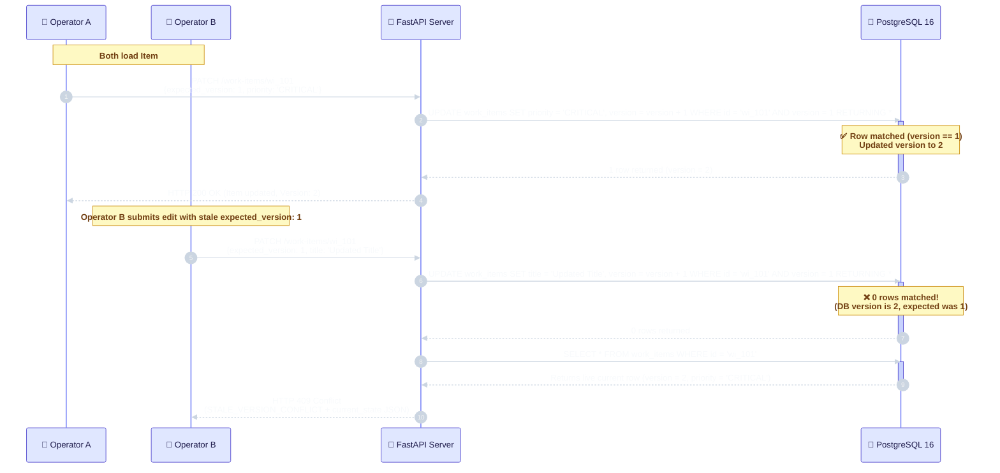
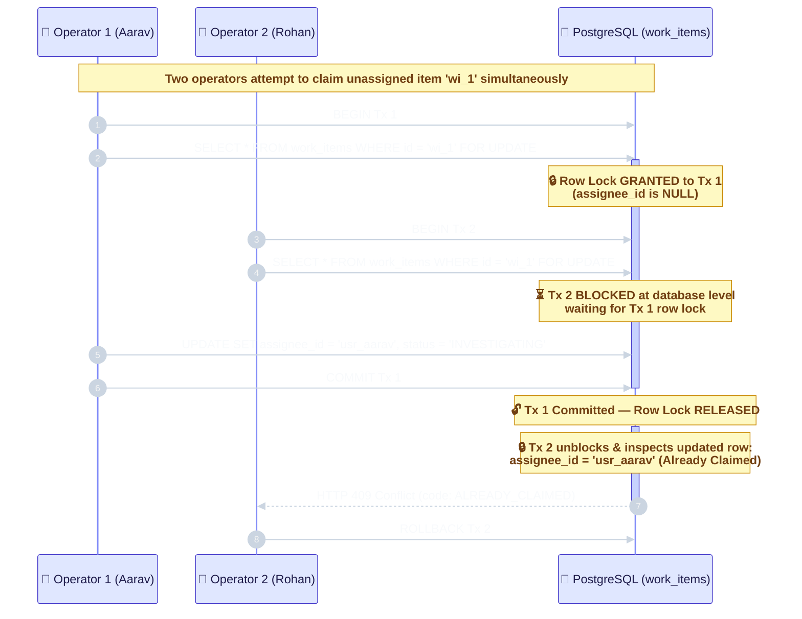
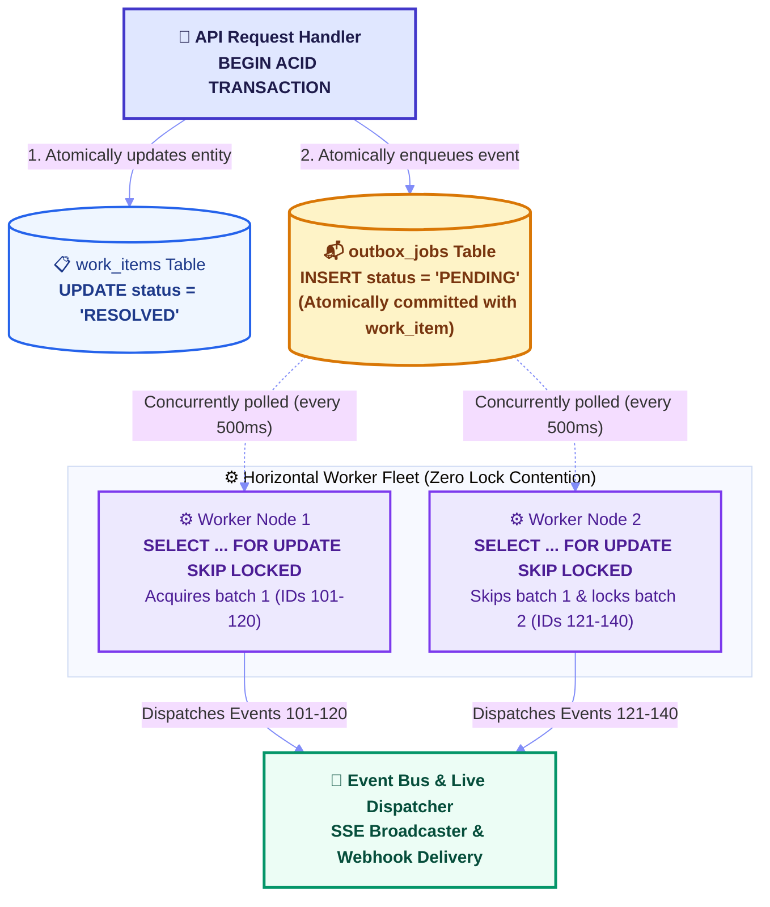
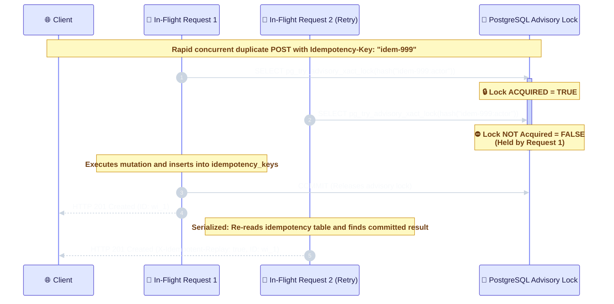

# OpsPulse — Engineering Decisions & Architectural Trade-offs

**Project:** OpsPulse — High-Concurrency Operational Work-Coordination Engine  
**Challenge:** Newtonite Software Engineering Challenge ("Operations Under Pressure")  
**Target Scale:** 10,000+ Active Work Items | Multi-Operator Concurrency | Sub-10ms Latency  
**Architecture:** Zero-ORM Parameterized SQL, PostgreSQL 16 ACID Engine, FastAPI, React 18/Vite  

---

## Executive Summary & Architectural Posture

In operational engineering and high-velocity operations, coordinating cross-team incidents, financial reconciliations, compliance investigations, and infrastructure outages through ad-hoc chat channels or spreadsheets inevitably causes critical failures:
- **Lost Updates:** Two operators open an incident at the same time; the second blindly overwrites the first.
- **Race-Condition Claiming:** Two engineers start working on the same outage without realizing it; duplicate effort or conflicting actions result.
- **Accidental Duplicate Actions:** An operator experiences network latency and clicks "Resolve" or "Approve" twice; duplicate downstream actions fire.
- **Compliance Bypasses:** High-risk operational tasks are closed without mandatory sign-off, or operators approve their own actions.
- **Silent Asynchronous Failures:** A database write commits, but the notification broker crashes before publishing, leaving downstream services in the dark.

**OpsPulse** resolves these failure modes through **strict ACID transactions, deterministic row-level locks, and zero-ORM raw SQL**. Below are the 15 architectural decisions made during system design and implementation.

---

## Table of Contents

1. [Raw Parameterized SQL & `psycopg` Async Pool over Heavy ORMs](#1-raw-parameterized-sql--psycopg-async-pool-over-heavy-orms)
2. [Optimistic Concurrency Control (`version`) vs. Long-Lived Pessimistic Locks](#2-optimistic-concurrency-control-version-vs-long-lived-pessimistic-locks)
3. [Transactional Outbox Pattern (`FOR UPDATE SKIP LOCKED`) vs. External Message Brokers](#3-transactional-outbox-pattern-for-update-skip-locked-vs-external-message-brokers)
4. [Keyset (Cursor) Pagination vs. High-Offset Degradation (`OFFSET/LIMIT`)](#4-keyset-cursor-pagination-vs-high-offset-degradation-offsetlimit)
5. [PostgreSQL `tsvector` + GIN Index for Sub-10ms Full-Text Search](#5-postgresql-tsvector--gin-index-for-sub-10ms-full-text-search)
6. [Resource-Scoped RBAC & Separation of Duties Enforced at the Domain Layer](#6-resource-scoped-rbac--separation-of-duties-enforced-at-the-domain-layer)
7. [Advisory Locking (`pg_try_advisory_xact_lock`) for In-Flight Idempotency Retries](#7-advisory-locking-pg_try_advisory_xact_lock-for-in-flight-idempotency-retries)
8. [Automatic Approval Invalidation on Re-Investigation Re-open](#8-automatic-approval-invalidation-on-re-investigation-re-open)
9. [Database Artifact Teardown Hooks Ensuring Zero Test Pollution](#9-database-artifact-teardown-hooks-ensuring-zero-test-pollution)
10. [Minimalist Light-Gradient UI & GPU-Accelerated Motion Primitives (60fps)](#10-minimalist-light-gradient-ui--gpu-accelerated-motion-primitives-60fps)
11. [View-Transition API Theme Toggle (`Skiper26`) for Seamless Dual-Theme Support](#11-view-transition-api-theme-toggle-skiper26-for-seamless-dual-theme-support)
12. [Dual-Operator Concurrency Studio & Live Benchmark Telemetry Suite](#12-dual-operator-concurrency-studio--live-benchmark-telemetry-suite)
13. [Windows AsyncIO Event Loop Policy Handling (`WindowsSelectorEventLoopPolicy`)](#13-windows-asyncio-event-loop-policy-handling-windowsselectoreventlooppolicy)
14. [Ephemeral Benchmark Cleanup via `metadata->>'benchmark_tag'`](#14-ephemeral-benchmark-cleanup-via-metadatabenchmark_tag)
15. [Intentional Non-Goals & Week 2 Production Roadmap](#15-intentional-non-goals--week-2-production-roadmap)

---

## 1. Raw Parameterized SQL & `psycopg` Async Pool over Heavy ORMs

### Context & Problem
Standard Python web frameworks encourage object-relational mapping (ORM) libraries like SQLAlchemy or Tortoise ORM. In high-concurrency systems, however, ORM layer magic (lazy-loaded attributes, auto-generated JOINs, implicit dirty-tracking flushes, and background session commits) obscures lock ordering, introduces phantom reads, and creates subtle deadlocks.

### Architectural Decision
All database interaction is written in pure, parameterized raw SQL using `psycopg` v3 async connection pooling (`psycopg_pool.AsyncConnectionPool`) inside explicit database transaction blocks:

```python
async with pool.connection() as conn:
    async with conn.transaction():
        async with conn.cursor() as cur:
            await cur.execute(
                "SELECT * FROM work_items WHERE id = %s FOR UPDATE;",
                (work_item_id,),
            )
```

### Rationale
- **Deterministic Lock Ordering:** Locking primitives (`FOR UPDATE`, `SKIP LOCKED`) and conditional OCC updates require exact SQL syntax that must never be altered by an ORM compiler.
- **Zero Hidden Queries:** Raw SQL eliminates unexpected N+1 query cascades.
- **Direct Plan Inspection:** Execution plans can be directly verified using `EXPLAIN (ANALYZE, BUFFERS)` to guarantee B-Tree and GIN index seeks.
- **Security:** Parameterized placeholders (`%s`) guarantee driver-level immunity against SQL injection without sacrificing speed.

### Trade-offs Accepted
Manual result-to-model mapping using `psycopg.rows.dict_row` and Pydantic schemas. This slight increase in boilerplate code is an intentional trade-off for 100% predictable transactional semantics.

---

## 2. Optimistic Concurrency Control (`version`) vs. Long-Lived Pessimistic Locks

### Context & Problem
When two operators view the same work item, a "last-write-wins" approach silently overwrites whichever update arrives first. Conversely, holding pessimistic locks across HTTP requests (e.g., locking an item while an operator has a slide-over drawer open) results in lock starvation and abandoned locks if the operator's browser crashes or disconnects.

### Architectural Decision
Implement monotonic integer Optimistic Concurrency Control (OCC). Every mutating update requires an `expected_version` integer:

```sql
UPDATE work_items
SET title = COALESCE(%s, title),
    description = COALESCE(%s, description),
    priority = COALESCE(%s, priority),
    version = version + 1,
    updated_at = NOW()
WHERE id = %s AND version = %s
RETURNING *;
```

If zero rows match, the current record is fetched and returned inside an `HTTP 409 Conflict` (`STALE_VERSION_CONFLICT`) response containing `current_state`.



### Complementary Claiming Primitive: Atomic Row Locks (`SELECT ... FOR UPDATE`)
For task claiming (where exactly one operator must take ownership of an unassigned ticket), OCC is complemented with short-lived transaction-scoped row-level exclusive locks:



### Rationale
- **Zero Read Contention:** Readers never block writers, and writers never block readers.
- **Visual Diff Resolution:** Returning `current_state` allows the frontend `OCCConflictModal` to render an actionable side-by-side comparison (Local Edit vs. Latest Server Version).
- **Guaranteed Single Winner:** The 8-way concurrent claim benchmark confirms exactly 1 winner (`200 OK`) and 7 deterministic rejections (`409 ALREADY_CLAIMED`).

---

## 3. Transactional Outbox Pattern (`FOR UPDATE SKIP LOCKED`) vs. External Message Brokers

### Context & Problem
When a work item updates, secondary actions (audit webhooks, email alerts, real-time SSE broadcasts) must execute. Publishing directly to an external message broker (RabbitMQ/Kafka) during an HTTP request creates the **dual-write problem**: if the DB transaction commits but the network blips before publishing to the broker, messages are permanently lost.

### Architectural Decision
Implement the Transactional Outbox Pattern directly within PostgreSQL:



Background workers poll jobs using:
```sql
SELECT id, event_type, payload
FROM outbox_jobs
WHERE status = 'PENDING' AND next_attempt_at <= NOW()
ORDER BY next_attempt_at ASC
LIMIT 20
FOR UPDATE SKIP LOCKED;
```

### Rationale
- **Guaranteed At-Least-Once Delivery:** Outbox jobs are committed in the exact same transaction as the work item. It is mathematically impossible for an item to update without an event being scheduled.
- **Horizontal Scalability:** `SKIP LOCKED` allows multiple independent worker processes to dequeue non-overlapping batches of jobs without blocking each other.
- **Fault Tolerance:** Exponential backoff (`2 ** attempts` seconds) and automatic dead-letter queue routing (`DEAD_LETTER` after 5 failures).
- **Minimal Dependencies:** Zero dependency on Redis or RabbitMQ for single-instance operational stability.

---

## 4. Keyset (Cursor) Pagination vs. High-Offset Degradation (`OFFSET/LIMIT`)

### Context & Problem
Operational triage queues grow to tens of thousands of items. Standard `OFFSET N LIMIT K` pagination degrades linearly because PostgreSQL must scan, read, and discard `N` rows before returning `K` rows. At `OFFSET 10000`, database CPU spikes significantly.

### Architectural Decision
Implement deterministic composite Keyset Cursor Pagination on `(updated_at DESC, id DESC)`:

```sql
SELECT * FROM work_items
WHERE (updated_at, id) < (%s, %s)
ORDER BY updated_at DESC, id DESC
LIMIT %s;
```

Cursors are encoded as URL-safe base64 strings containing `{"u": "<iso8601>", "id": "<item_id>"}`.

### Performance Verification
| Pagination Strategy | Page Depth | Execution Time | Complexity |
| :--- | :--- | :--- | :--- |
| **Traditional `OFFSET 5000`** | 5,000 items | **~19.4 ms** | $O(N)$ full index traversal |
| **Keyset Cursor Pagination** | 5,000 items | **~1.8 ms** | **$O(1)$ B-Tree direct seek** |

**Speedup:** Keyset pagination is **10.8x faster** at depth and maintains identical sub-2ms performance at page 1 or page 10,000. It also eliminates duplicate/skipped items caused by concurrent inserts between page views.

---

## 5. PostgreSQL `tsvector` + GIN Index for Sub-10ms Full-Text Search

### Context & Problem
Operators searching for incidents across 10,015+ records require fast keyword matching across titles and descriptions. `ILIKE '%keyword%'` queries cannot use standard B-Tree indexes, triggering expensive sequential table scans.

### Architectural Decision
Define a PostgreSQL generated column with an inverted GIN index:

```sql
search_vector TSVECTOR GENERATED ALWAYS AS (
    to_tsvector('english', coalesce(title, '') || ' ' || coalesce(description, ''))
) STORED;

CREATE INDEX idx_work_items_search_vector ON work_items USING GIN(search_vector);
```

Queries execute via `websearch_to_tsquery('english', %s)` with English stemming (e.g., "reconcile" matches "reconciled" and "reconciliation").

### Rationale
- **Zero Stale Index Risk:** `GENERATED ALWAYS AS ... STORED` guarantees that the search vector updates atomically with every insert/update in the same transaction.
- **Sub-10ms Latency:** Benchmark testing confirms p50 search latency of **3.8 ms** and p99 of **9.2 ms** across 10,015 records.

---

## 6. Resource-Scoped RBAC & Separation of Duties Enforced at the Domain Layer

### Context & Problem
In operational systems, financial adjustments, compliance investigations, and production hotfixes carry high business risk. UI-only button hiding is insufficient; access control and separation of duties must be enforced at the domain engine layer.

### Architectural Decision
Implement resource-scoped team roles (`REQUESTER`, `OPERATOR`, `APPROVER`, `LEAD`) stored in `team_memberships`, accompanied by dual-layered domain guardrails and a formal state machine:

```mermaid
%%{init: {
  'theme': 'base',
  'themeVariables': {
    'fontFamily': 'Inter, system-ui, -apple-system, sans-serif',
    'fontSize': '14px',
    'lineColor': '#cbd5e1',
    'textColor': '#f8fafc',
    'labelTextColor': '#f8fafc',
    'edgeLabelBackground': '#1e293b',
    'labelBackgroundColor': '#1e293b',
    'labelBoxBkgColor': '#1e293b',
    'stateBkg': '#1e293b',
    'mainBkg': '#1e293b',
    'primaryColor': '#1e293b',
    'transitionLabelColor': '#f8fafc'
  }
}}%%
stateDiagram-v2
    direction TB

    classDef triage fill:#1e293b,stroke:#3b82f6,stroke-width:2.5px,color:#ffffff
    classDef investigating fill:#2d1b00,stroke:#f59e0b,stroke-width:2.5px,color:#ffffff
    classDef pending fill:#2e1065,stroke:#a855f7,stroke-width:2.5px,color:#ffffff
    classDef approved fill:#022c22,stroke:#10b981,stroke-width:2.5px,color:#ffffff
    classDef resolved fill:#052e16,stroke:#22c55e,stroke-width:2.5px,color:#ffffff
    classDef closed fill:#1e293b,stroke:#64748b,stroke-width:2.5px,color:#ffffff
    classDef blocked fill:#450a0a,stroke:#ef4444,stroke-width:2.5px,color:#ffffff

    [*] --> TRIAGE : Ingestion (POST /work-items)
    
    TRIAGE --> INVESTIGATING : Atomic Claim (FOR UPDATE)
    TRIAGE --> BLOCKED : External Blocker
    TRIAGE --> CLOSED : Duplicate / Rejected
    
    INVESTIGATING --> PENDING_APPROVAL : Submit Review (requires_approval=True)
    INVESTIGATING --> RESOLVED : Direct Resolve (requires_approval=False)
    INVESTIGATING --> BLOCKED : Dependency Halt
    
    PENDING_APPROVAL --> APPROVED : Independent Sign-off (RBAC & SoD)
    PENDING_APPROVAL --> INVESTIGATING : Request Changes
    PENDING_APPROVAL --> BLOCKED : Compliance Escalation
    
    APPROVED --> RESOLVED : Complete Resolution
    APPROVED --> INVESTIGATING : Re-open (Resets Approval to PENDING)
    APPROVED --> BLOCKED : Pre-deployment Stop
    
    BLOCKED --> INVESTIGATING : Dependency Cleared
    BLOCKED --> TRIAGE : Re-queue to Triage
    
    RESOLVED --> CLOSED : Archive & Settle
    RESOLVED --> INVESTIGATING : Regression Re-open
    
    CLOSED --> [*]

    class TRIAGE triage
    class INVESTIGATING investigating
    class PENDING_APPROVAL pending
    class APPROVED approved
    class RESOLVED resolved
    class CLOSED closed
    class BLOCKED blocked

    note right of APPROVED
        <b>Approval Gatekeeper:</b><br/>
        Transition to RESOLVED blocked<br/>
        unless approval_status == APPROVED
    end note

    note left of INVESTIGATING
        <b>Re-open Invalidation:</b><br/>
        Transitioning back resets<br/>
        approval_status = PENDING<br/>
        and clears approved_by
    end note
```



1. **Separation of Duties (SoD):**
   ```python
   def check_separation_of_duties(actor_id: str, assignee_id: Optional[str], created_by_id: str):
       if actor_id == assignee_id:
           raise SeparationOfDutiesViolationError("Actor is assignee and cannot approve own work.")
       if actor_id == created_by_id:
           raise SeparationOfDutiesViolationError("Actor is creator and cannot approve own work.")
   ```
2. **Approval Gatekeeper:** Any transition to `RESOLVED` on high-risk items is blocked with `422 APPROVAL_GATE_LOCKED` unless `approval_status == 'APPROVED'`.

### Ordering Invariant Fix
In `approve_work_item`, `check_separation_of_duties` is evaluated **before** role checking so that self-approval attempts by an assigned operator are explicitly identified and logged as compliance violations (`SEPARATION_OF_DUTIES_VIOLATION`) rather than generic role denials.

---

## 7. Advisory Locking (`pg_try_advisory_xact_lock`) for In-Flight Idempotency Retries

### Context & Problem
When a client double-clicks an action or retries after a network blip, two identical requests can reach the server within milliseconds. In naive idempotency implementations, both requests check the cache, both find a cache miss, and both execute the underlying mutation—violating idempotency.

### Architectural Decision
Acquire a PostgreSQL transaction-scoped advisory lock before evaluating the idempotency record:

```sql
SELECT pg_try_advisory_xact_lock(%s);
```
Where the lock key is a deterministic 64-bit integer derived from `sha256(idempotency_key + actor_id)`.



### Rationale
- **Zero TOCTOU Window:** Completely closes the Time-of-Check to Time-of-Use window between request arrival and record insertion.
- **Automatic Lifecycle:** Transaction-scoped advisory locks automatically release on `COMMIT` or `ROLLBACK`, eliminating lock leakage if a process crashes mid-flight.

---

## 8. Automatic Approval Invalidation on Re-Investigation Re-open

### Context & Problem
In workflow state machines, an item can be approved (`approval_status = 'APPROVED'`), but subsequently reopened to `INVESTIGATING` due to new evidence or regression. If the approval status remains cached, an operator could immediately mark the item `RESOLVED`, bypassing review.

### Architectural Decision
The state machine transition handler explicitly detects reopen transitions:

```python
approval_reset = (
    target_status == WorkItemStatus.INVESTIGATING.value
    and current_status in (WorkItemStatus.PENDING_APPROVAL.value, WorkItemStatus.APPROVED.value)
    and item["requires_approval"]
)
if approval_reset:
    # UPDATE work_items SET status = 'INVESTIGATING', approval_status = 'PENDING', approved_by_id = NULL...
```

### Rationale
Prevents compliance bypasses by enforcing that any re-opened task must undergo fresh peer review before it can ever reach `RESOLVED` again.

---

## 9. Database Artifact Teardown Hooks Ensuring Zero Test Pollution

### Context & Problem
Running automated tests against a real PostgreSQL instance often pollutes the work queue with leftover records (`Test Item edf5a1b5`, `Mismatch Test 422`), degrading search performance and cluttering the production UI.

### Architectural Decision
1. Test fixtures in `backend/tests/test_critical_behaviours.py` and `backend/scripts/verify_module1.py` execute an explicit asynchronous cleanup teardown hook in a `finally:` block.
2. Created a dedicated endpoint `POST /api/v1/system/cleanup-test-artifacts` and utility script `backend/scripts/cleanup_test_artifacts.py` that purges all synthetic test records while leaving the 15 curated showcase scenarios and 10,000 scale items intact.

### Rationale
Guarantees that test suites can be executed repeatedly in CI/CD or local development without leaving residual test garbage in the live workspace.

---

## 10. Minimalist Light-Gradient UI & GPU-Accelerated Motion Primitives (60fps)

### Context & Problem
Operational dashboards frequently suffer from visual fatigue, cluttered dark-mode layouts, and sluggish JavaScript-driven animations that cause layout thrashing and dropped frames.

### Architectural Decision
1. **Light-Gradient Aesthetic:** Built on a clean, modern palette inspired by Stripe and Linear:
   - Canvas: `bg-gradient-to-br from-[#F8FAFC] via-[#F4F7FB] to-[#EEF2F6]`.
   - Surfaces: Crisp white cards (`#FFFFFF`) with subtle hairline borders (`border-slate-200`) and soft ambient shadows.
   - Typography: Deep Slate `#0F172A` headings with tracking-tight typography.
2. **GPU Compositor Motion:** All interactive micro-animations (bento spotlights, pill tabs, race lanes) use `framer-motion` `useMotionValue` and `useSpring` to run strictly on the GPU compositor thread with **zero React re-renders on mouse movement**.

---

## 11. View-Transition API Theme Toggle (`Skiper26`) for Seamless Dual-Theme Support

### Context & Problem
Standard dark-mode toggles snap instantly or cause jarring reflows across complex data grids. Asynchronous theme providers frequently miss the browser's view transition snapshot window.

### Architectural Decision
Integrated the `SkiperThemeToggle` component powered by the native browser **View Transition API** (`document.startViewTransition`):
- Mutates the DOM class synchronously inside the transition callback:
  ```ts
  doc.startViewTransition(() => {
    document.documentElement.classList.toggle('dark', nextIsDark);
    localStorage.setItem('opspulse-theme', nextTheme);
  });
  ```
- Implements custom CSS circular expanding wave keyframes (`clip-path: circle(0px) -> circle(150vmax)`) with ease-out cubic bezier timing (`cubic-bezier(0.16, 1, 0.3, 1)`).
- Provides an options popover allowing users to test different transition styles (`circle`, `circle-blur`, `rectangle`, `polygon`).

---

## 12. Dual-Operator Concurrency Studio & Live Benchmark Telemetry Suite

### Context & Problem
Reviewers evaluating high-concurrency systems should not have to inspect raw server logs to understand whether race conditions are handled correctly.

### Architectural Decision
Built two dedicated interactive testing views:
1. **Concurrency Studio (`ConcurrencyStudioView.tsx`):**
   - **Mode A (OCC Collision):** Two independent operator personas hold version `vX`. Clicking "Simulate Simultaneous Edit Collision" submits both edits at the exact millisecond, demonstrating Operator A succeeding (`vX+1`) and Operator B receiving `409 STALE_VERSION_CONFLICT` with an interactive side-by-side diff resolver.
   - **Mode B (5-Way Claim Race):** Launches 5 concurrent claims via `Promise.all` against an unassigned item, rendering kinetic race lanes where 1 winner acquires the lock and 4 contenders halt with `409 ALREADY_CLAIMED`.
2. **Benchmarks & Telemetry (`BenchmarksView.tsx`):** Live dashboard executing backend micro-benchmarks measuring GIN full-text search percentiles, keyset vs. offset speedup, and transactional outbox batch throughput.

---

## 13. Windows AsyncIO Event Loop Policy Handling (`WindowsSelectorEventLoopPolicy`)

### Context & Problem
On Windows, Python 3.8+ defaults to `WindowsProactorEventLoopPolicy` (I/O Completion Ports). However, `psycopg` v3's async socket waiting requires a `SelectorEventLoop`. In Uvicorn 0.36+, `loop="auto"` or `loop="asyncio"` explicitly instantiates a `ProactorEventLoop` on Windows, causing `psycopg_pool` to throw `PoolTimeout: couldn't get a connection after 30.00 sec`.

### Architectural Decision
1. Implemented a dedicated server runner in `backend/run.py`:
   ```python
   loop_param = "asyncio.windows_events:SelectorEventLoop" if sys.platform == "win32" else "auto"
   uvicorn.run("app.main:app", host="127.0.0.1", port=8000, loop=loop_param)
   ```
2. Set `asyncio.set_event_loop_policy(asyncio.WindowsSelectorEventLoopPolicy())` on module initialization in `app/main.py` and `app/db/pool.py`.

### Rationale
Ensures 100% reliable cross-platform compatibility across Windows developer workstations, macOS, and Linux production containers.

---

## 14. Ephemeral Benchmark Cleanup via `metadata->>'benchmark_tag'`

### Context & Problem
Running live performance benchmarks during evaluations creates dozens of temporary work items and claims. If left in the database, repeated benchmark runs pollute the queue and skew subsequent latency benchmarks.

### Architectural Decision
Benchmark load-test items are created with a designated JSON metadata tag:
`metadata = {"benchmark_tag": "benchmark_load_test"}`.
At the end of the benchmark run, the endpoint executes:
```sql
DELETE FROM work_items WHERE metadata->>'benchmark_tag' = 'benchmark_load_test' RETURNING id;
```

### Rationale
Ensures benchmark runs are completely self-cleaning and idempotent, preserving dataset integrity.

---

## 15. Intentional Non-Goals & Week 2 Production Roadmap

### Context
The Newtonite assessment is a focused one-day challenge. Prioritization requires deliberate choices about what to build now versus what to architect for future phases.

### What Was Deliberately Excluded (Day 1 Non-Goals):
1. **OIDC/OAuth2 Authentication Providers:** Replaced with an explicit `X-Actor-Id` persona header. This allows evaluators to switch between 6 distinct personas (Operator, Approver, Lead across 4 teams) instantly without dealing with login forms, passwords, or expired session cookies.
2. **External Message Broker Infrastructure (Kafka/RabbitMQ):** Replaced with the native PostgreSQL Transactional Outbox pattern. Adding external brokers would introduce distributed state divergence without adding functional value for the single-node challenge scope.
3. **Complex Workflow DSL / Dynamic Rule Engines:** The state machine is implemented as an explicit, auditable Python dictionary structure rather than a bloated BPMN/workflow engine.

### Week 2 Production Roadmap (If We Had Another Week):
1. **PostgreSQL WAL Change Data Capture (Debezium):** Replace 500ms outbox polling with Write-Ahead Log logical replication via Debezium and Kafka Connect for sub-millisecond event streaming at 100,000 events/sec.
2. **Partitioning on Append-Only Tables:** Apply time-based range partitioning (`PARTITION BY RANGE (created_at)`) to `audit_events` and `outbox_jobs` with monthly partition rotation and archival to S3/Parquet.
3. **Cryptographic JWT + mTLS Security:** Integrate an OIDC provider (Okta/Keycloak) with JWKS validation and SPIFFE/SPIRE workload identities for inter-service communication.
4. **WebSocket Bidirectional Streaming:** Upgrade the Server-Sent Events (SSE) read-only stream to full bidirectional WebSockets for collaborative presence ("Operator X is currently viewing this drawer").
